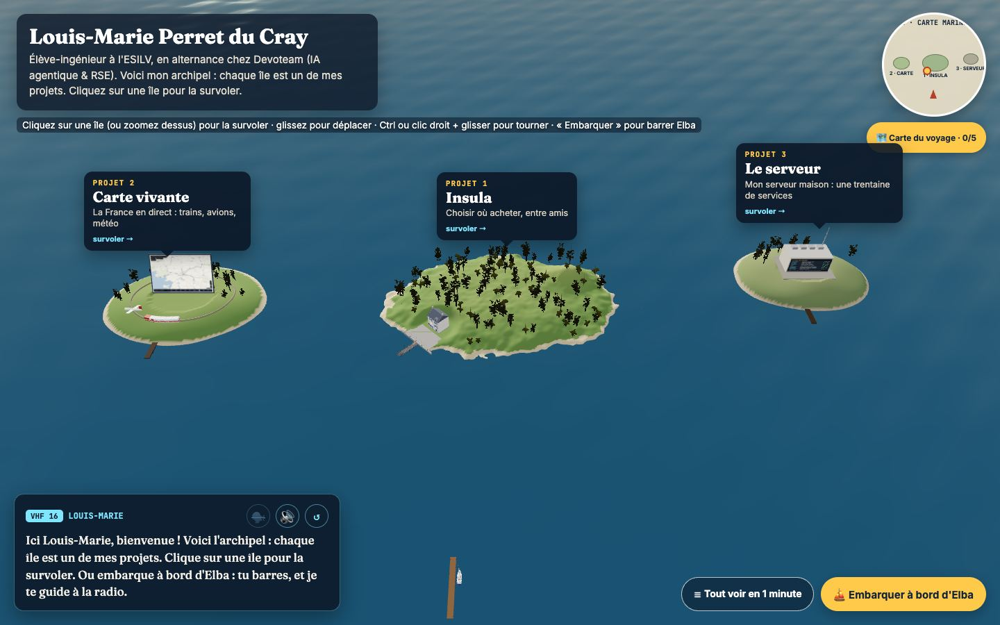
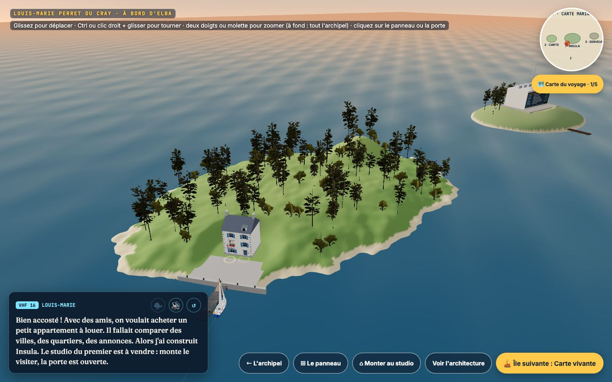
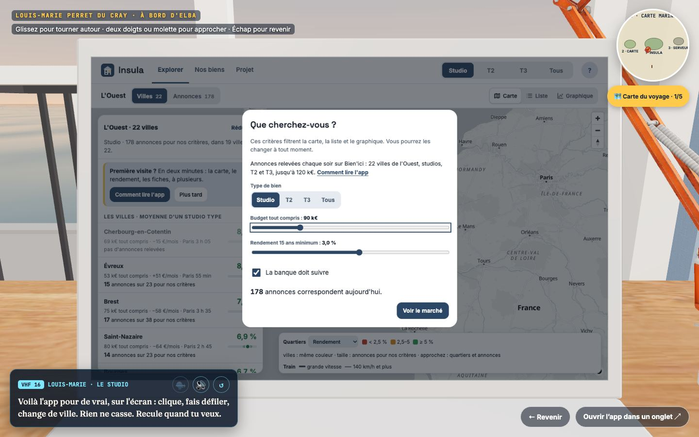
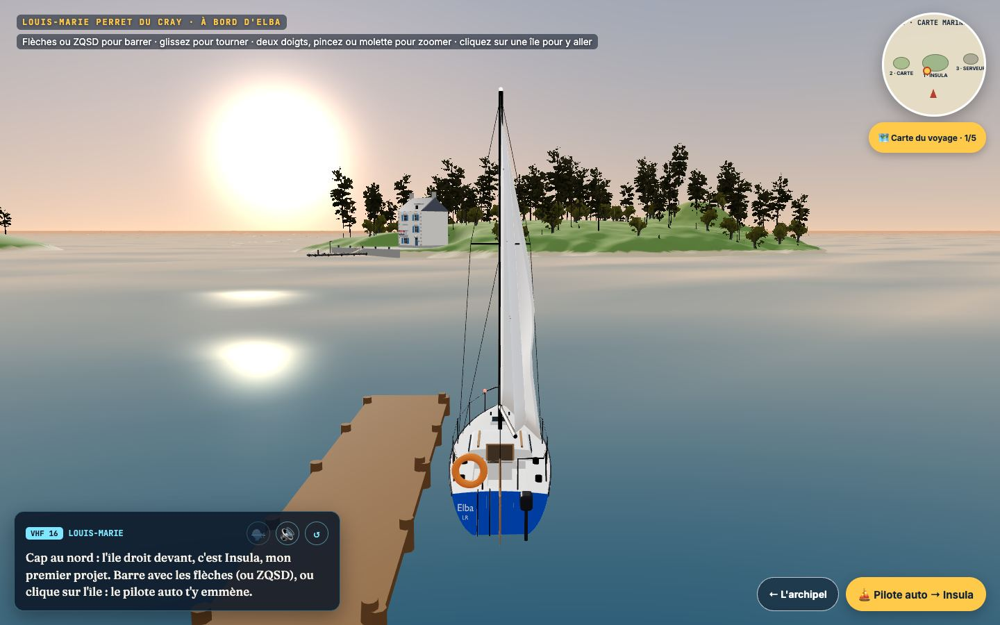
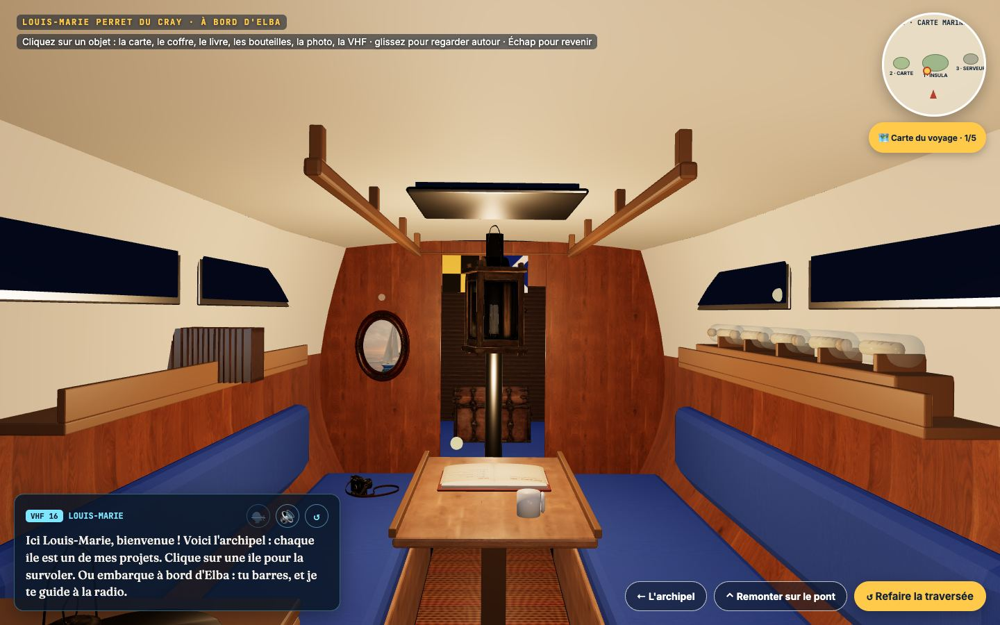

<p align="center">
  
</p>

<h1 align="center">louis-marie.du-cray.eu</h1>

<p align="center">
  <a href="https://louis-marie.du-cray.eu"></a>
  
  
  <a href="LICENSE"></a>
</p>

Mon site personnel est un monde marin en 3D. On embarque à bord d'*Elba*, mon voilier (un Flirt de 1977), et on navigue d'île en île. Chaque île est un de mes projets. Je guide la traversée à la radio, et on finit dans la cabine, où l'on apprend qui je suis.

Pas de fiches qui s'ouvrent : on clique sur les objets, la caméra s'en approche, et on lit ce qui est écrit dessus. Tout le site tient dans une page HTML, quelques fichiers JavaScript et des modèles glTF faits dans Blender.

## Le parcours

| Étape | Ce qu'on y fait |
|---|---|
| **L'archipel** | Vue aérienne des trois îles. On survole une île d'un clic, ou on embarque. |
| **Le ponton** | On prend la barre d'Elba (flèches ou ZQSD), ou on laisse le pilote auto. |
| **Insula** | Un immeuble sur le quai, avec un panneau « À vendre » au balcon. On monte au studio témoin : la vraie app sur l'écran du portable, les annonces imprimées, le carnet des amis, la fiche sur le frigo. |
| **Carte vivante** | La France en temps réel : trains, avions, météo. |
| **Le serveur** | Mon serveur maison et sa trentaine de services. |
| **La cabine** | Mon parcours sur une carte marine, mon CV dans un coffre, des anecdotes en bouteille, le livre de bord du visiteur, et la VHF pour me contacter. |

<p align="center">
  
  
  
  
</p>

Une version texte (« Tout voir en 1 minute », depuis l'archipel) résume tout. Elle sert aussi aux lecteurs d'écran, aux moteurs de recherche et aux navigateurs sans WebGL.

## Lancer en local

```bash
python3 -m http.server 8000      # dans ce dossier, puis http://localhost:8000
```

Rien à installer ni à construire : la page charge `vendor/three.min.js` et les fichiers de `js/` tels quels.

Pour les vérifications et le parcours de test (Node 20 ou plus) :

```bash
cd outils && npm install
npm run verifier                 # syntaxe, fichiers cités, voix, poids : ce que GitHub vérifie à chaque envoi
npm run parcours                 # parcours complet dans Chrome (le site doit tourner sur le port 8000)
```

## Structure du dépôt

```
index.html            la page : couche HTML (radio, boutons, carte du voyage, version texte)
style.css
js/                   le monde 3D, un fichier par partie (voir docs/architecture.md)
vendor/               three.js r128 et GLTFLoader
assets/               modèles glTF, textures, vidéo, musique, voix de la VHF, CV en PDF
docs/                 documentation et captures
outils/               tout ce qui fabrique assets/ : scripts Blender, voix, CV, vidéo, vérifications, tests
```

## Documentation

| Document | Pour |
|---|---|
| [Architecture](docs/architecture.md) | comprendre le code : les fichiers, les phases du parcours, la boucle de rendu, les repères |
| [Le parcours](docs/parcours.md) | ce que vit le visiteur, et les choix de conception qui vont avec |
| [Les gestes](docs/gestes.md) | souris, trackpad, écran tactile, clavier |
| [Les modèles 3D](docs/modeles-3d.md) | refaire les modèles avec Blender : Elba, l'île d'Insula, le studio, la cabine |
| [Le son](docs/son.md) | la musique, l'ambiance, et la voix de la VHF (à régénérer après chaque texte modifié) |
| [Publication](docs/publication.md) | mise en ligne, cache, vérifications |
| [Crédits](docs/credits.md) | modèles, textures, musique et voix tiers, avec leur licence |
| [Journal des changements](CHANGELOG.md) | les grandes étapes |

## Pile technique

- **Rendu** : [three.js](https://threejs.org) r128, sans framework. Une seule classe `Component` est répartie sur plusieurs fichiers. `main.js` reporte son état sur le HTML.
- **Modèles** : Blender 5, construits par des scripts Python (`outils/3d/scripts`) puis exportés en glTF binaire. Les meubles et les arbres viennent de [Poly Haven](https://polyhaven.com) (CC0).
- **Son** : Web Audio. L'ambiance marine est générée dans le navigateur, la musique est du domaine public, et la voix de la VHF est une synthèse [Piper](https://github.com/rhasspy/piper).
- **Hébergement** : Cloudflare, déployé à chaque envoi sur `main`.

## Licence

Le code (HTML, CSS, JavaScript et les outils) est sous [licence MIT](LICENSE), © 2026 Louis-Marie Perret du Cray.

Les textes, le CV, les photos et les modèles faits pour ce site (Elba, la cabine, l'immeuble et son studio) ne sont pas couverts par cette licence : tous droits réservés. Les éléments tiers gardent leur licence, voir [Crédits](docs/credits.md).
