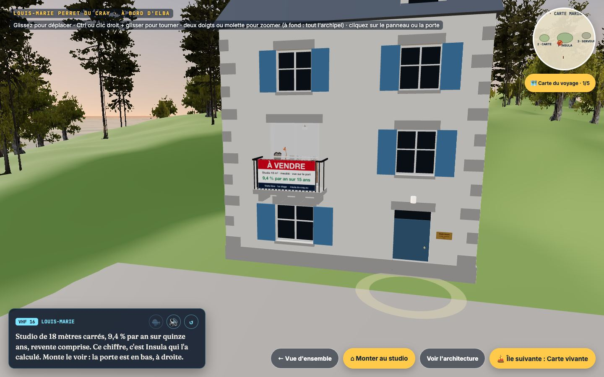

# Le parcours

Le site raconte une traversée. Le visiteur tient la barre, et je le guide à la VHF. Les textes de la radio sont dans `PR_RADIO` (`scene.js`, complété par `archipel.js`), `PR_STU_RADIO` (`studio.js`) et `PR_CAB_RADIO2` (`cabin3d.js`).

## Les règles du jeu

- **Pas de fiche qui s'ouvre.** On clique sur un objet, la caméra s'en approche, l'objet s'anime, et on lit ce qui est écrit dessus.
- **On peut toujours bouger.** Même quand on regarde un objet, on tourne autour et on s'approche. Échap ou « ← Revenir » ramène en arrière.
- **Une chose à faire à la fois.** La VHF dit l'action suivante en une phrase. Il y a peu d'objets actifs à la fois, et des anneaux ou des points dorés les signalent.
- **On est toujours à bord.** Sur une île, Elba est amarrée au quai. Les boutons d'île en île passent par le pilote auto, et la carte du voyage permet de sauter n'importe où.
- **Rien n'est perdu.** Les lieux vus sont gardés (`elba-escales`), et « Refaire la traversée » repart du ponton sans effacer la progression.

## Les étapes

### 1. L'archipel
On arrive en vue aérienne sur les trois îles, une par projet. Un clic sur une île la survole, et « ⛵ Embarquer » amène au ponton. « Tout voir en 1 minute » ouvre la version texte.

### 2. Le ponton et la mer
On largue les amarres et on barre avec les flèches ou ZQSD. Un clic sur une île, ou le pilote auto, y mène. La carte marine, en haut à droite, montre la route en pointillés.

### 3. Insula (île n° 1)

L'île est là pour montrer **la question à laquelle répond Insula** : « on veut acheter un studio entre amis, mais où ? ». Elle ne cherche pas à décrire l'app.

- **Sur le quai**, un seul immeuble porte un panneau « À vendre » au balcon : *Studio 18 m², 9,4 % par an sur 15 ans*. Deux anneaux dorés signalent le panneau et la porte.
- **La porte** (« Studio témoin · 1er étage ») fait monter la caméra le long de la façade, puis la fait entrer par la porte-fenêtre, sans fondu au noir.
- **Dans le studio**, chaque objet raconte une seule chose :
  - **l'ordinateur** : la démo tourne au repos ; en s'approchant, la vraie app s'affiche sur l'écran et se manipule ;
  - **les annonces imprimées**, surlignées et annotées (« celui-là ! », « bof ») ;
  - **le carnet des amis** : les critères, les biens suivis, l'avis de chacun ;
  - **la fiche sur le frigo** : le bien qu'on a préféré ;
  - **les clés** : la caméra se tourne vers la baie et Elba au ponton, puis « Larguer les amarres » vers l'île suivante.

« Voir l'architecture » montre les coulisses : le chemin de la donnée, des sources publiques jusqu'à l'app.

 

### 4. La Carte vivante (île n° 2) et le serveur (île n° 3)
Ces deux îles se survolent. La Carte vivante tourne seulement sur mon réseau local : son île montre donc des captures et un lien vers le code. Le serveur liste ses services.

### 5. La cabine
On descend par l'ouverture du rouf. On y trouve :
- la carte de mon parcours (de Précigné à Levallois) ;
- le coffre, qui contient le CV en PDF ;
- les bouteilles à message, pour quelques anecdotes ;
- la photo, qu'on retourne pour lire quelques mots sur moi ;
- le livre de bord, qui raconte la traversée du visiteur ;
- la VHF, pour m'écrire.

## Les choix abandonnés, et pourquoi

| Essayé | Abandonné parce que |
|---|---|
| Une île dont chaque bâtiment est une brique technique d'Insula | la métaphore était forcée, même en « mode plan » |
| Un village de 22 maisons, une par ville | on recopiait l'app en maisons, sans rien montrer de plus |
| Un cinéma en plein air et une longue-vue | ils faisaient double emploi avec l'ordinateur du studio |
| Une agence avec son bureau, son écran et une télé | trop d'écrans montraient la même app |
| L'app en plein écran par-dessus la 3D | on sortait du monde ; elle est maintenant sur le portable |
